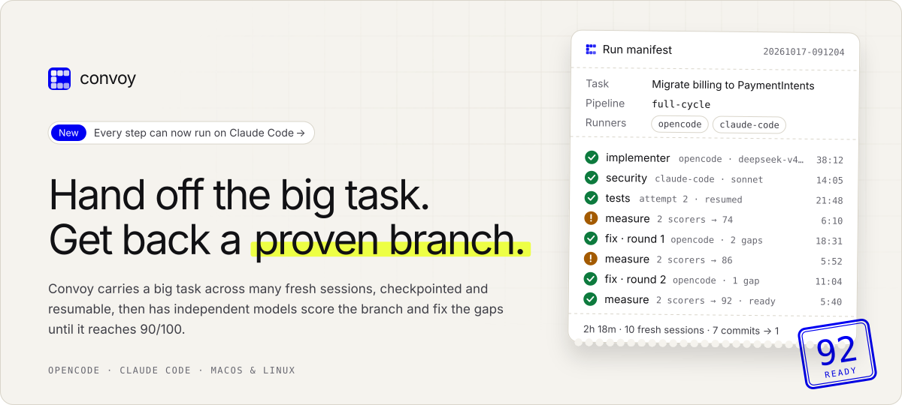
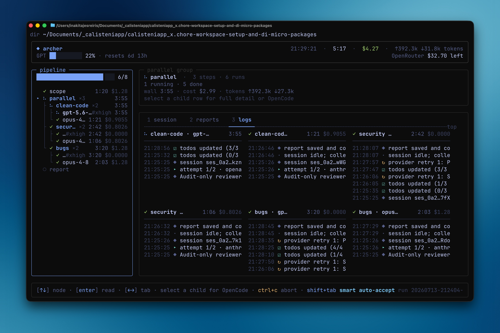

<p align="center">
  <a href="https://convoy.inaki.cc"></a>
</p>

<p align="center">
  <a href="https://github.com/Inakitajes/convoy/actions/workflows/ci.yml"></a>
  <a href="./assets/coverage.svg"></a>
  <a href="https://github.com/Inakitajes/convoy/releases"></a>
  
</p>

<p align="center">
  <a href="https://convoy.inaki.cc"><b>Website</b></a> ·
  <a href="docs/getting-started.md">Install</a> ·
  <a href="docs/README.md">Docs</a> ·
  <a href="docs/pipelines.md">Pipelines</a> ·
  <a href="https://github.com/Inakitajes/convoy/releases">Releases</a>
</p>

One agent session runs out of context on a big task, then grades its own work. Convoy carries the task across many fresh sessions, checkpointed and resumable, then has independent models score the branch and fix the gaps until it reaches **90/100**. On OpenCode, Claude Code, Codex, or any mix.

<p align="center">
  
</p>

## Why Convoy

- **Goes the distance.** A big task runs as phases. Each one starts with a fresh context and ends in a commit, so a run can detach, resume, and keep going for hours. [Running Convoy →](docs/running.md)
- **Proves the result.** Two independent scorers grade the branch against a fixed rubric, and fix rounds target only the gaps they found until it reaches 90/100. [Quality and goals →](docs/quality-and-goals.md)
- **Bring your harness.** Every step runs on [OpenCode](https://opencode.ai), [Claude Code](https://code.claude.com), or [Codex](https://developers.openai.com/codex) (experimental), mixed per step, with advisors from any of them. A model is spelled the same everywhere; the step's `runner` picks the harness. [Runners →](docs/runners.md)
- **Same rules for every agent.** Per-step policies (read-only, verify, write) apply to every tool call. Agents can't commit or push. [Safety →](docs/safety.md)
- **Everything stays local.** Logs, transcripts, reports, and costs live next to your Git history. Worktrees and OpenSpec changes keep each piece of work isolated. [Worktrees →](docs/worktrees.md) · [OpenSpec →](docs/openspec.md)

## Get started

Requires macOS or Linux, Git, and at least one installed, authenticated runner: [OpenCode](https://opencode.ai), [Claude Code](https://code.claude.com), or [Codex](https://developers.openai.com/codex). Bun is bundled in the release binary.

> [!WARNING]
> **Codex support is experimental.** It runs on Codex's app-server protocol, which OpenAI itself labels experimental, and it has had less real-world use than OpenCode and Claude Code. Expect rough edges and breaking changes between releases, and check the branch before you merge it. Please [report issues](https://github.com/Inakitajes/convoy/issues). [Codex in Convoy →](docs/runners.md#how-convoy-integrates-with-codex)

```sh
curl -fsSL https://github.com/Inakitajes/convoy/releases/latest/download/install.sh | sh
```

Run `convoy` in your project to open the terminal UI, or start from the CLI:

```sh
convoy --prompt-file prd.md       # implement, measure, and fix with full-cycle
convoy -p review                  # report-only review of the current branch
convoy -p claude-full-cycle       # the full cycle on Claude Code alone
```

Convoy also runs headless, so a script or another agent can supervise it. `convoy skill install` teaches Claude Code, OpenCode, and Codex sessions to compose a pipeline for a task, launch it detached, and follow it with `convoy runs <id> --wait`:

```sh
convoy skill install              # then ask your agent: "run a Convoy review of this branch", or type /convoy-review
```

See [installation and updates](docs/getting-started.md), [provider setup](docs/models.md), [driving Convoy from a script or agent](docs/running.md#driving-convoy-from-a-script-or-agent), and [agent sessions](docs/agents.md).

## Pick a pipeline

| Pipeline | Purpose |
|---|---|
| `full-cycle` · default | Implement, audit, polish, and test, then score and fix gaps until the branch reaches 90/100. |
| `implement` | Implement and audit, then write a run recap. No scoring loop. |
| `ship` | Sync with the base, review and fix findings, then reach the quality target. |
| `review` | Produce findings and a verified score without changing code. |
| `fixer` | Prove supplied findings with regression tests, fix them, and verify the result. |
| `hunter` | Audit six specialty tracks across five models, then reconcile the findings. |
| `claude-full-cycle` | The full cycle on Claude Code alone, scored by Opus and Sonnet. |
| `claude-review` | A report-only Claude Code review, synthesized by Opus. |

Every pipeline is YAML you can copy and change, or write in a file of its own and run with `--pipeline-file`. `convoy pipelines` lists what can run. [Models, steps, and stopping rules →](docs/pipelines.md)

## Documentation

| Guide | Covers |
|---|---|
| [Getting started](docs/getting-started.md) | Requirements, installation, and upgrades |
| [Pipelines](docs/pipelines.md) | Built-ins, models, and migration from earlier variants |
| [Runners](docs/runners.md) | OpenCode, Claude Code, and Codex: models, routes, auth, billing, and parity |
| [Quality and goals](docs/quality-and-goals.md) | Scoring rubric and improve/measure loops |
| [Worktrees](docs/worktrees.md) | Home, isolation, spin, and close |
| [OpenSpec](docs/openspec.md) | Spec-driven runs and the artifact reader |
| [Running Convoy](docs/running.md) | CLI, TUI, headless runs, history, and resume |
| [Agent sessions](docs/agents.md) | The Convoy skill for Claude Code, OpenCode, and Codex |
| [Configuration](docs/configuration.md) | Agents, advisors, prompts, hooks, and attachments |
| [Permissions and safety](docs/safety.md) | Approval policies, commits, compaction, and publication |
| [Models and providers](docs/models.md) | Authentication and model gateways |
| [Development](docs/development.md) | Building, testing, and the source layout |

## License

[MIT](LICENSE) © Iñaki Tajes
